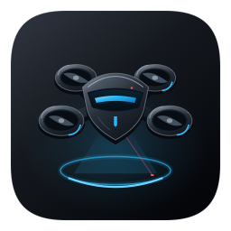
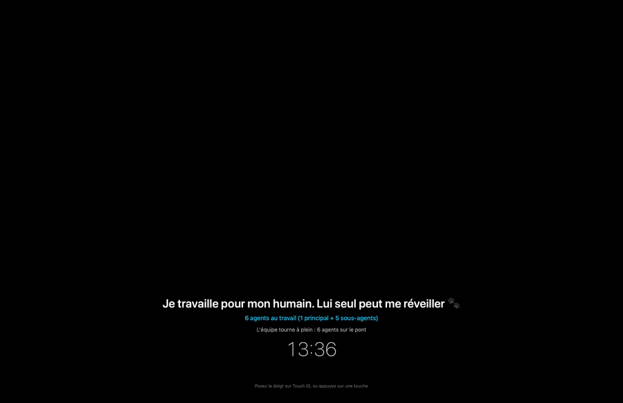

<p align="center"></p>

<h1 align="center">Hoverguard</h1>

<p align="center"><strong>Un drone garde votre écran pendant que vos agents IA travaillent.</strong><br>
Développé par <strong>Utahpik</strong> · macOS et Windows · gratuit et open source (MIT)</p>

<p align="center">
  
  
  
  
</p>

<p align="center"></p>

Vous lancez Claude Code, Codex, Gemini ou Cursor sur une longue tâche et vous quittez votre bureau ? Hoverguard pose
un voile sur tous vos écrans : personne ne voit ce qui s'y passe, le vrai clavier et la vraie souris sont bloqués…
et **vos agents continuent de travailler**. Ils voient l'écran, cliquent, tapent et pilotent le navigateur comme si de
rien n'était. Un drone monte la garde, ses lasers balaient la pièce, et le compteur montre combien d'agents (et de
sous-agents) sont au travail.

**🎁 Les 1 000 premiers reçoivent Hoverguard Pro à vie : ce sont les Fondateurs.**

## Ce qui le distingue
- **Les agents gardent la main.** Le voile est exclu des captures d'écran et laisse passer les clics et les frappes
  envoyés par les logiciels ; seules les entrées du matériel (clavier, souris, trackpad) sont bloquées. Les
  applications dessous restent « visibles » pour le système : le navigateur ne se met pas en veille.
- **On revient comme sur un Mac en veille** : poser le doigt sur Touch ID suffit, ou appuyer sur une touche — le drone
  s'approche et demande le mot de passe de la session (sur Windows : le mot de passe Hoverguard choisi au premier
  lancement). Échap le renvoie surveiller.
- **Un drone 3D** sur chaque écran, en vol stationnaire avec ses lasers quand des agents travaillent, posé sinon.
- **Le Mac reste éveillé** pendant la garde, et le voile demande d'être branché s'il passe sur batterie. Un mode
  « garder éveillé » sans voile est aussi dans le menu.
- **Au retour** : un rapport (durée, agents terminés, tentatives d'accès, photo éventuelle de l'intrus).
- **En option** : garde automatique après quelques minutes sans activité, notifications iMessage sur l'iPhone.

## Ce que Hoverguard n'est pas
Hoverguard protège **la vue et le clavier**, c'est un outil de confidentialité. **Ce n'est pas un verrou de sécurité** :
pour une vraie protection, utilisez le verrouillage du système (⌃⌘Q sur Mac, ⊞ + L sur Windows). Lisez
[SECURITY.md](SECURITY.md) avant de compter dessus.

## Installer
### macOS (26 ou plus récent)
1. Téléchargez `Hoverguard-x.y.z.dmg` dans les [Releases](../../releases) et glissez **Hoverguard** dans **Applications**.
2. Premier lancement : macOS indique qu'il ne peut pas vérifier le développeur (l'app n'est pas notarisée par Apple).
   Ouvrez **Réglages Système › Confidentialité et sécurité**, puis **Ouvrir quand même** en bas de la page.
3. Autorisez Hoverguard dans **Réglages Système › Confidentialité et sécurité › Accessibilité** : c'est ce qui lui
   permet de bloquer le clavier et la souris. Une seule fois : les mises à jour sont signées avec le même certificat
   Utahpik, macOS garde l'autorisation.

Ou compilez-le vous-même :
```
brew install xcodegen
cd macos && make installer
```

### Windows 10 (version 2004 ou plus récent) / 11
1. **Téléchargez** [`Hoverguard-Setup.exe`](https://github.com/AnthonyTrtre/hoverguard/releases/latest/download/Hoverguard-Setup.exe).
2. **Edge bloque le téléchargement** (« n'est pas fréquemment téléchargé ») : c'est normal, l'installateur n'est pas
   signé par un éditeur payant. Survolez le fichier dans la liste des téléchargements, cliquez sur **⋯** ›
   **Conserver**, puis **Afficher plus** › **Conserver quand même**.
3. **Lancez `Hoverguard-Setup.exe`**. Si Windows affiche « Windows a protégé votre ordinateur », cliquez sur
   **Informations complémentaires** › **Exécuter quand même**.
4. Hoverguard s'installe pour votre compte (sans droits d'administrateur), avec un raccourci dans le menu Démarrer,
   et ouvre ses réglages : **choisissez votre mot de passe Hoverguard** (4 caractères au moins, il peut être le même
   que votre code Windows). C'est lui qui lèvera la garde.
5. C'est prêt. L'icône est près de l'horloge (sous la flèche **^** : glissez-la dans la barre des tâches pour la
   garder visible). **Ctrl + Win + W** pose la garde. Le fichier téléchargé peut être supprimé.

Ces avertissements n'apparaissent qu'à l'installation : les mises à jour arrivent ensuite toutes seules. Détails,
raccourcis et limites : [windows/README.md](windows/README.md).

## Brancher vos agents
Menu Hoverguard › Réglages › Agents : un clic ajoute les « hooks » de Claude Code, Codex, Gemini CLI ou Cursor (une
copie de sauvegarde de leur fichier de réglages est faite). Chaque outil prévient alors Hoverguard par une URL locale
`hoverguard://agent?nom=…&etat=travail|attente|fini`. Rien ne sort de votre ordinateur.

**Contrôle de l'ordinateur par Claude (macOS) sous la garde.** L'outil de contrôle de l'ordinateur de l'app Claude
refuse un clic « plein écran » (`left_click`) dès qu'une fenêtre d'une app non autorisée est sous le point visé. Or le
voile couvre tout l'écran, et Hoverguard, app de barre des menus, ne peut pas être ajouté aux apps autorisées. Sous la
garde, les agents doivent donc utiliser les outils qui ciblent une fenêtre (`app_click`, `app_type`, `app_screenshot`…),
qui traversent le voile, ou l'extension Claude in Chrome. Le voile reste transparent aux clics : c'est seulement ce
contrôle préalable de l'outil qui refuse.

## Mises à jour
**Windows** : une fois par jour, Hoverguard regarde la dernière Release de ce dépôt ([Velopack](https://velopack.io)),
télécharge la nouvelle version en arrière-plan et l'installe quand le PC est inutilisé depuis 10 minutes ou quand vous
le quittez, jamais pendant une garde. Réglages › Garde permet de couper les mises à jour automatiques.

**Mac** : Hoverguard se met à jour tout seul : une fois par jour, il regarde la dernière Release de ce dépôt
(`appcast.xml`), télécharge la nouvelle version en arrière-plan et l'installe quand vous le quittez, jamais pendant une
garde. Chaque archive est signée par Utahpik (EdDSA, [Sparkle](https://sparkle-project.org)) : une archive modifiée est
refusée. La signature de l'app ne change pas d'une version à l'autre, donc l'autorisation Accessibilité est gardée.
Réglages › Garde permet de couper la vérification ou l'installation automatique.

## Vie privée
Aucune télémétrie. La seule connexion réseau est la vérification des mises à jour auprès de GitHub (désactivable),
qui ne transmet rien d'autre que la requête elle-même. Les photos d'intrus restent sur votre disque. Les notifications iMessage
(désactivées par défaut) partent de votre propre app Messages, vers vous-même.
En cas de plantage, Hoverguard propose au lancement suivant d'ouvrir une issue GitHub pré-remplie (sans votre nom ni
celui de la machine) ; rien n'est envoyé sans votre clic.
Un souci ou une idée ? L'entrée « Dites-le-nous… » du menu ouvre une issue avec la version et le système, à
écrire et envoyer vous-même.

## Licence et marque
Le code est sous licence [MIT](LICENSE) : vous pouvez l'utiliser, le modifier et le redistribuer, en gardant la
mention de copyright. Les noms **Hoverguard** et **Utahpik**, ainsi que leurs logos, ne sont pas couverts par cette
licence : une version modifiée et redistribuée doit porter un autre nom.

---
© 2026 Utahpik.
